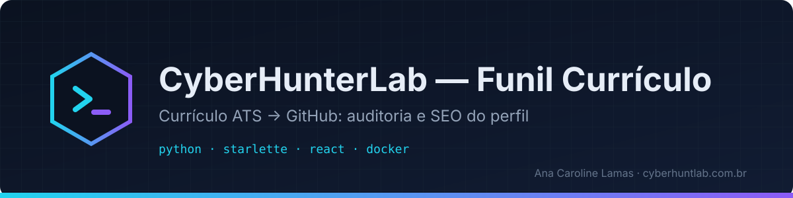

<p align="center"></p>

# CyberHunterLab — funil Currículo ATS → GitHub e Engenheiro Reverso

Monorepo com duas aplicações que rodam localmente ou com Docker:

- **Funil Currículo ATS → GitHub** (`apps/api`): API em Python (Starlette) e CLI que cruzam um currículo (PDF, DOCX ou TXT) com o perfil do GitHub. Elas auditam o perfil, comprovam habilidades com repositórios reais, sugerem SEO de títulos e topics e geram um currículo compatível com **ATS**.
- **Engenheiro Reverso** (`apps/engenheiro-reverso`): aplicação Vite + React com servidor Express que analisa arquivos ZIP/APK com defesas contra *Zip Slip* e *zip bomb*, publica conteúdo no GitHub e inclui o menu `/curriculo-ats`, que consome o funil.

## Recursos do funil

1. **Auditoria do GitHub**: bio, nome, site, README de perfil, descrições, topics, licenças e repositórios vazios, genéricos ou forks.
2. **Checklist de habilidades**: cada habilidade do currículo marcada como `COMPROVADA`, `SEM_EVIDENCIA` ou `SO_NO_GITHUB`, com os repositórios que a comprovam.
3. **SEO de títulos**: bio sugerida, nomes em kebab-case e rascunhos de descrição e topics.
4. **Projetos em destaque**: ranking justificado de até 6 repositórios fixados.
5. **Veredito do perfil**: nota de 0 a 100 com critérios ponderados e inconsistências entre currículo e GitHub.
6. **README do perfil**: proposta editável, publicada por pull request **somente com confirmação explícita e token de escrita**.
7. **Currículo ATS**: aponta problemas de colunas, seções e datas e gera uma versão em coluna única.

O sistema nunca inventa cargos, datas ou certificações: as lacunas aparecem como `[PENDENTE]`. Ele também não altera a visibilidade de repositórios e não armazena nem registra tokens em log.

## Instalação

Requisitos: **Python 3.10+**, **poppler-utils** (`pdftotext`, para ler currículos em PDF), **Node.js 20+** e, opcionalmente, Docker.

```bash
git clone https://github.com/ticarollamas-arch/cyberhunterlab-funil-curriculo-github.git
cd cyberhunterlab-funil-curriculo-github
```

### API e CLI do funil

```bash
cd apps/api
pip install -r requirements.txt
cp .env.example .env        # CORS_ORIGINS, FUNNEL_RATE_PER_MIN, GITHUB_TOKEN (opcional)
uvicorn cyberhunter_api.server:app --port 8000
```

### Engenheiro Reverso

```bash
cd apps/engenheiro-reverso
cp .env.example .env        # FUNNEL_API_URL=http://127.0.0.1:8000
npm install
npm run dev                 # http://localhost:3000/curriculo-ats
```

### Tudo com Docker

```bash
docker compose up --build
```

## Como usar

Interface web do funil em `http://localhost:8000`, ou pela CLI:

```bash
python -m cyberhunter_api.cli --resume curriculo.pdf --github usuario --out saida/
python -m cyberhunter_api.cli --resume curriculo.pdf --snapshot snapshot.json   # modo offline
```

Testes (17 casos com currículo e snapshot fictícios):

```bash
cd apps/api && python -m pytest -q
```

### API

| Método | Rota | Descrição |
|---|---|---|
| GET | `/api/health` | Status e lista das etapas |
| POST | `/api/funnel/run` | Executa o funil (`resume` em base64 ou `resume_text`, `github_username`, `github_token`, `snapshot`, `include_email`) |
| POST | `/api/funnel/apply` | Abre PR no repositório de perfil; sem `confirm: true` devolve 409 com uma prévia |

A API aplica um limite de execuções por IP por minuto (`FUNNEL_RATE_PER_MIN`).

Detalhes do que foi executado e do que está planejado em [docs/STATUS.md](docs/STATUS.md).

## Tecnologias

Python · Starlette · Uvicorn · poppler (pdftotext) · pytest · TypeScript · React · Vite · Tailwind CSS · Express · adm-zip · JSZip · Google GenAI SDK · Docker

## Licença

Distribuído sob a licença MIT. Veja [LICENSE](LICENSE).
